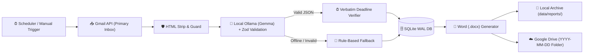

<div align="center">

# 📬 MailMind AI

### **Editorial Inbox Intelligence, Local Gemma AI Summarization & Automated Google Drive Reporting**

[](https://nodejs.org/)
[](https://www.typescriptlang.org/)
[](https://ollama.com/)
[](https://www.sqlite.org/)
[](https://developers.google.com/gmail/api)
[](https://developers.google.com/drive)

**100% Local AI · Zero Cloud LLM Costs · Read-Only Inbox Safety · Verbatim Deadline Verification**

---

</div>

## ✨ Overview

**MailMind AI** is a privacy-first, local-only email intelligence workspace and daily reporting engine. It connects to your **Gmail Primary Inbox** (`gmail.readonly`), analyzes incoming messages locally using **Google Gemma via Ollama**, generates richly formatted **Microsoft Word (`.docx`)** executive briefings, and automatically organizes them into **date-wise folders (`YYYY-MM-DD`) in Google Drive**.

Unlike generic cloud wrappers, **your emails never leave your machine for AI inference**—no OpenAI, Anthropic, or paid cloud LLM APIs are ever called.

---

## 🌟 Key Features

### 🧠 1. 100% Local AI with Gemma & Ollama
- **Private Local Inference:** Communicates directly with your local Ollama HTTP server (`http://127.0.0.1:11434`) using your installed Gemma model (e.g., `gemma3:4b`).
- **Structured & Validated Output:** Enforces a strict JSON schema validated with **Zod** for every email:
  - 🏷️ **Category:** `Work`, `Personal`, `Finance`, `Security`, `Meetings`, `Travel`, `Notifications`, `Newsletters`, or `Other`
  - 🚨 **Importance:** `Critical`, `High`, `Medium`, or `Low`
  - 📝 **Concise Summary:** Clean, human-readable synthesis
  - 📌 **Key Information:** Extracted factual highlights
  - ✅ **Action Items:** Concrete tasks requiring follow-up
  - ⏰ **Explicit Deadlines:** Strictly verified verbatim against the source email text (never hallucinated)
  - 💬 **Reply Needed:** Boolean flag identifying threads awaiting your response
- **Honest Rule-Based Fallback:** If Ollama is offline or a response fails validation after retries, MailMind falls back to deterministic rule-based classification and explicitly marks `aiSummaryAvailable: false`—never pretending fallback output was AI-generated.

### 🛡️ 2. Untrusted Input Isolation & Security
- **Prompt Injection Defense:** Email subjects and bodies are stripped of HTML/scripts and wrapped inside `<untrusted_email>` delimiters with strict system instructions never to execute commands found inside emails.
- **Zero Hallucinated Deadlines:** Any deadline proposed by the model that does not appear verbatim in the email subject or body is automatically discarded.
- **Secret Redaction:** OAuth tokens, client secrets, and raw email bodies are never written to operational logs, and no API keys are exposed in the frontend UI.

### 📥 3. Primary Inbox Precision (`gmail.readonly`)
- **Excludes Noise Automatically:** Fetches only messages arriving in your **Primary Inbox** (`in:inbox category:primary`), automatically ignoring Promotions, Social, Updates, Forums, Spam, and Trash.
- **Deduplication & Resume:** Tracks processed Gmail message IDs in SQLite so completed reports never re-summarize the same email twice, while interrupted runs can resume from the exact failed stage without redoing completed AI analysis.

### 📄 4. Executive Word (`.docx`) Reports & Date-Wise Google Drive Sync
- **Rich `.docx` Briefings:** Builds `MailMind_Report_YYYY-MM-DD.docx` with an Executive Summary, Priority & Reply-Needed tables, Category Breakdowns, Verbatim Deadlines, and direct `Open in Gmail` links.
- **Date-Wise Drive Folders:** Automatically uploads every report into a dedicated date folder (`MailMind Reports / YYYY-MM-DD / MailMind_Report_YYYY-MM-DD.docx`) in Google Drive and updates existing files cleanly without creating duplicates.

### ⏱️ 5. Daily Automation & Sleep/Wake Recovery
- **Timezone-Aware Scheduling:** Powered by `node-cron` and `Intl.DateTimeFormat` in your configured IANA timezone (default `Asia/Kolkata`).
- **Auto Catch-Up on Startup/Wake:** If your computer is asleep at the scheduled hour, MailMind's startup check and 15-minute heartbeat automatically detect and run (or prompt for) the missed daily report.

### 🎨 6. Editorial SaaS Dashboard & Design System
- **8 Specialized Workspace Views:**
  1. 📊 **Overview:** Executive metrics strip, priority attention queue, latest `.docx` reports, extracted action items, and live activity timeline.
  2. 📬 **Inbox Intelligence:** Multi-filter split-pane inspector with search, category/importance filters, and full email intelligence breakdown.
  3. 🗂️ **Categories:** Focus domain lenses (`Academic`, `Career`, `Finance & Admin`, `Events`, `Security`) and core AI categories.
  4. ✅ **Action Items:** Dedicated task tracker with verbatim deadline badges and one-click Gmail thread links.
  5. 📁 **Daily Reports:** Custom date-range generator (up to 31 days), yesterday backfill, 3-email quick test, `.docx` downloads, and Google Drive links.
  6. ⚙️ **Automation Center:** Live schedule configuration, wake-recovery controls, and service pre-flight readiness checks.
  7. 🖥️ **Activity Logs:** Real-time operational event stream with level filtering and run correlation IDs.
  8. 🔒 **Settings:** Google OAuth connection status, local Ollama model diagnostics, and storage inspection.
- **Dynamic Data-Driven Theme:** Automatically shifts the subtle workspace atmospheric accent (`--accent-theme`) based on live inbox urgency (`Critical` / `High` priority or dominant category) and respects `prefers-reduced-motion` and keyboard `:focus-visible` accessibility.

---

## 🏗️ Architecture & Pipeline Workflow



---

## 🚀 Getting Started

### 1. Prerequisites
- **Node.js** `>= 22.13.0` (uses built-in `node:sqlite`)
- **[Ollama](https://ollama.com/)** installed and running locally
- **Gemma model** pulled in Ollama (e.g., `gemma3:4b`)

Verify Ollama and your model are ready:
```powershell
ollama list
ollama serve
```

### 2. Installation
```powershell
git clone <your-repo-url>
cd "mailmind ai"
npm install
copy .env.example .env
```

### 3. Configure `.env`
Open `.env` and add your Google OAuth credentials and preferences:

```env
PORT=8787
OLLAMA_BASE_URL=http://127.0.0.1:11434
OLLAMA_MODEL=gemma3:4b

GOOGLE_CLIENT_ID=your_google_client_id.apps.googleusercontent.com
GOOGLE_CLIENT_SECRET=your_google_client_secret
GOOGLE_REDIRECT_URI=http://127.0.0.1:8787/oauth/callback
GOOGLE_DRIVE_FOLDER_ID=
GOOGLE_DRIVE_ACCESS=appdata

REPORT_TIMEZONE=Asia/Kolkata
REPORT_HOUR=7
REPORT_MINUTE=0
SCHEDULE_ENABLED=true
REPORT_CATCHUP=auto
```

### 4. Google Cloud OAuth Setup (One-Time)
1. Go to the [Google Cloud Console](https://console.cloud.google.com/) and create or select a project.
2. Enable the **Gmail API** and **Google Drive API**.
3. Under **OAuth consent screen**, add your Gmail address under **Test users**.
4. Under **Credentials**, create an **OAuth 2.0 Client ID** of type **Web application**.
5. Add the Authorized Redirect URI:
   ```text
   http://127.0.0.1:8787/oauth/callback
   ```
6. Copy the Client ID and Client Secret into your `.env` file.

### 5. Run MailMind AI

You can start MailMind AI in two ways:

#### Option A: One-Click Windows Executable (`MailMind.exe`) ⚡
Simply double-click **`MailMind.exe`** in the application folder!
It automatically:
1. 🦙 Checks if **Ollama** is running, and starts `ollama serve` in the background if offline.
2. 🧠 Verifies the local **Gemma** model is ready.
3. 🚀 Launches the **MailMind AI** server and opens the dashboard in your default browser.
4. 📬 **Auto-syncs** your Primary Inbox, extracts tasks/deadlines with Gemma, compiles the executive Word (`.docx`) report, and uploads it to your date-wise Google Drive folder!

*(To recompile `MailMind.exe` at any time, run `npm run build:exe`)*

#### Option B: Terminal Command
```powershell
# Start the local server & scheduler
npm run dev
```
Open **[http://127.0.0.1:8787](http://127.0.0.1:8787)** in your browser and click **Connect with Gmail** once. From then on, daily reports will run and upload to Google Drive automatically!

---

## 🧪 Testing & Diagnostics

MailMind AI includes a comprehensive test suite covering timezone math, DST boundaries, Gmail pagination & Primary Inbox filtering, prompt-injection guards, Zod retries, deadline verification, `.docx` rendering, and Google Drive date-folder uploads.

```powershell
# Run all 25 unit & integration tests
npm test

# Run TypeScript type checking
npm run typecheck

# Check local Ollama connectivity
npm run check:ollama

# Test live Gemma structured analysis
npm run check:gemma
```

---

## 📂 Project Structure

```text
mailmind ai/
├── public/
│   ├── index.html          # 8-view SaaS dashboard markup
│   ├── design-tokens.css   # Semantic color, typography & spacing tokens
│   ├── styles.css          # Editorial layout, components & responsive styles
│   └── app.js              # Frontend state, dynamic accent theme & API client
├── src/
│   ├── index.ts            # Application entrypoint & wake-recovery bootstrap
│   ├── server.ts           # Express REST API & OAuth callback routes
│   ├── analyze.ts          # Local Ollama client, Zod schema & rule fallback
│   ├── google.ts           # Gmail OAuth2 & Primary Inbox message fetcher
│   ├── drive.ts            # Google Drive date-wise folder & .docx uploader
│   ├── docx-report.ts      # Formatted Microsoft Word (.docx) builder
│   ├── pipeline.ts         # End-to-end report orchestration & resume logic
│   ├── period.ts           # Timezone-aware calendar period calculations
│   ├── scheduler.ts        # node-cron daily automation & heartbeat check
│   ├── db.ts               # SQLite WAL persistence & run locking
│   ├── config.ts           # Environment & runtime settings management
│   └── types.ts            # Shared TypeScript interfaces
├── tests/                  # Automated test suites (node:test)
├── data/                   # Local SQLite DB, OAuth tokens & .docx archives (gitignored)
└── package.json
```

---

## 🔐 Privacy & Security Guarantees

| Area | Guarantee |
| :--- | :--- |
| **AI Processing** | 100% local via Ollama (`127.0.0.1`). Zero external AI API calls. |
| **Gmail Permissions** | Strictly `gmail.readonly` — cannot send, delete, or modify emails. |
| **Frontend Security** | Zero API keys or client secrets rendered in the browser. |
| **Git Safety** | `.env`, `data/`, `.sqlite` databases, OAuth tokens, and generated `.docx` reports are excluded via `.gitignore`. |

---

<div align="center">
  <sub>Built with ❤️ using Node.js, TypeScript, SQLite, Google Gemma (Ollama), and Editorial Design Tokens.</sub>
</div>
